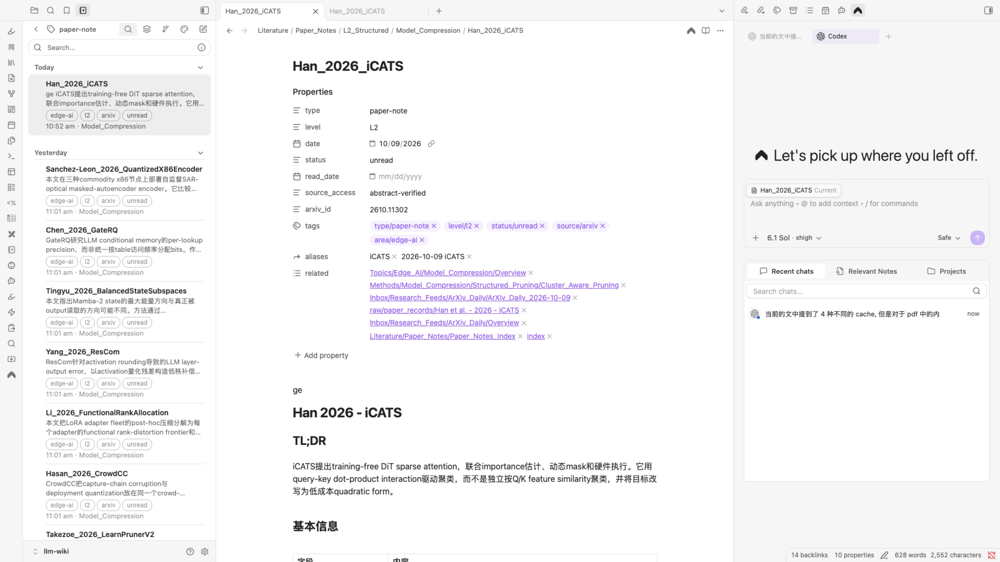

# 原生操作补测

日期：2026-10-29，Europe/Rome。用户要求继续测试。本轮补测上次未确认的真实原生按钮路径，未修改产品代码。

## 结果

| 场景         | 实际操作与后置条件                                                                                                                                            | 结果 |
| ------------ | ------------------------------------------------------------------------------------------------------------------------------------------------------------- | ---- |
| 重新检查     | 点击原生按钮；观察到 `Checking llm-wiki…`、按钮禁用、完成后恢复，以及检查时间从 10:49 更新到 10:50。                                                          | 通过 |
| 已有笔记     | 先在 Obsidian 切换到另一篇已打开笔记，再点击 TheRSS 原生打开按钮。观察到 `Opening Obsidian…`，随后 Obsidian 选中 `Han_2026_iCATS`，arXiv ID 为 `2610.11302`。 | 通过 |
| 仅有论文记录 | 选择 `2602.03060`，界面明确显示 `Paper record only`。点击原生打开按钮后，Obsidian 选中 `arxiv_2602.03060`。                                                   | 通过 |
| 未收录       | 使用明确标记为合成测试 ID 的 `9912.99999`。界面显示未找到记录，且没有打开按钮。                                                                               | 通过 |
| GitHub 项目  | 选择标记为验证样本的仓库项，原生阅读区没有论文收录状态块。                                                                                                    | 通过 |
| 受控只读复测 | 在再次通过原生按钮打开 iCATS 前后，比对该笔记及两份论文记录的 SHA-256。三个文件均一致。                                                                       | 通过 |
| 相关回归     | 六个测试文件、51 项测试通过；执行真实 Python 运行时的测试只操作隔离目录。                                                                                     | 通过 |
| 测试脚本     | ESLint、Prettier 和 Node 语法检查通过；正常退出会关闭验证应用并移除临时应用副本。                                                                             | 通过 |

本轮没有直接调用 preload API 来触发打开。测试通过 CUA 操作真实原生按钮，依据实际状态和 Obsidian 选中文件确认结果。
这覆盖应用按钮到真实知识库的业务路径，但不等同于人工鼠标、键盘或 VoiceOver 验收。
51 项回归与上一轮测试有重叠，不应累加为新的全量测试总数。

## 输入工具与测试环境

原生按钮点击仍可能返回 `AXError.failure`。本轮在错误返回后继续读取界面，实际观察到了“检查中”或“正在打开”，并核对完成结果。
因此不能把该工具错误直接当成按钮没有触发。错误的具体原因仍未确认。

安装版和项目包共享 `dev.dtjgp.therss`，工具明确报告应用标识歧义。本轮用具有独立标识的临时副本减少定位歧义；这并未消除按钮点击的辅助功能错误，不能称为该错误的根因修复。
副本仅改变测试标识并在本地进行 ad-hoc 签名。`app.asar` 与项目包的 SHA-256 相同，使用正式应用代码及真实状态服务。没有启用测试服务、网络检索或模型调用。

临时应用数据库中的标题、摘要和日期来自明确标记的验证夹具。真实数据核对限于 vault 中的论文身份、状态和打开目标；界面中的夹具日期不作为论文发表时间证据。

临时副本准备期间有两次启动失败。第一次复制把相对框架链接展开为原包的绝对路径；修正复制方式并重新签名后仍无法启动。
随后启动诊断明确报告 `Unable to find helper app`。保留原产品名、只改变标识后启动成功；Electron 需要原产品名来定位现有 helper。
这些失败来自测试副本的准备方式，没有改动产品包或已安装版本。失败副本及已关闭的验证副本均已清理。

打开后截图有一次 ScreenCaptureKit 流启动错误；再次截图成功。没有把失败的截图调用写成已取得证据。

## 笔记内容核对

检查时发现 iCATS 标题上方有未提交的 `ge`，文件修改时间为 10:52。用户明确确认这是自己的输入，已保留。
随后受控复测的三个文件哈希均未改变；本轮没有执行论文入库或主动编辑真实笔记。

## 证据

- [重新检查后的界面](continued-recheck.jpg)及[原生状态](continued-recheck-ax.txt)。
- [原生打开笔记结果](continued-open-obsidian.jpg)及[前后窗口记录](continued-open-proof.json)。
- [仅有记录的界面](continued-record-only.jpg)及[实际打开的记录](continued-open-record.jpg)。
- [未收录界面](continued-absent.jpg)、[GitHub 原生状态](continued-repository-ax.txt)和[四类状态记录](continued-matrix-proof.json)。
- [受控复测前哈希](continued-vault-before.json)与[复测后哈希](continued-vault-after.json)。
- [应用内容一致性与临时环境](continued-environment.json)。
- [51 项回归日志](continued-regression.txt)。



## 复现与范围

```sh
node docs/audits/2026-10-28-llm-wiki-status/verify-readonly.mjs --live --packaged --isolated-bundle --matrix
```

用输出中的临时应用路径连接界面。按 `q` 正常关闭。脚本创建独立应用数据库；实际 vault 只用于读取和打开现有文件。
本轮只更改测试脚本和证据文档，不新增产品功能。不安装、提交、推送或发布。
