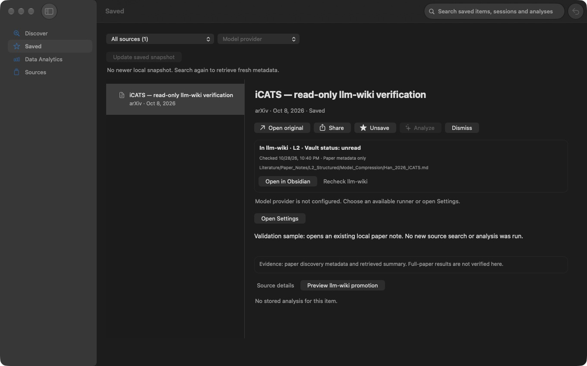
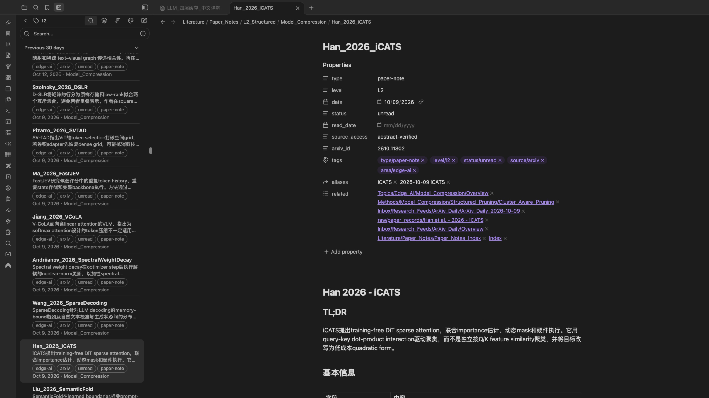

# llm-wiki 兼容修复与收录状态交付

完成日期：2026-10-29。分支：`codex/llm-wiki-state`。变更基于 `41c5aaf`，尚未提交、安装或发布。

## 结果

已修复当前 llm-wiki 的运行时兼容问题，并在原生 Discover、Saved 的现有阅读区增加收录状态、重新检查和在 Obsidian 打开。
界面不增加导航页、设置页或后台任务。真实 vault 的检查及 Obsidian 打开已验证；真实论文写入未执行。

用户要求继续测试后，已补充原生按钮的实际触发验证：重新检查、打开笔记、打开仅有的论文记录均通过；未收录与 GitHub 项目的显示条件也通过。参见[原生操作补测](CONTINUED_TESTING.md)。

| 项目       | 实现结果                                                                                                 |
| ---------- | -------------------------------------------------------------------------------------------------------- |
| 兼容性     | 审阅运行时 `f5c32763` 的变更后更新精确 SHA-256；继续校验运行时、租约和终态审计。                         |
| 已收录     | 规范化 arXiv 版本号，读取论文记录及 L1/L2 笔记的有限元数据。显示级别、阅读状态、检查时间和相对路径。     |
| 异常状态   | 分开显示未找到、仅有论文记录、关联笔记丢失、重复记录和无法检查。扫描不完整时不声称未收录。               |
| 打开       | 主进程重新检查目标，再构造 Obsidian URI。调用方只能提供 arXiv ID。优先打开笔记；只有论文记录时打开记录。 |
| 新入库结果 | 在原有论文记录中增加准确的 `paper_note` 链接。保留现有预览、确认、租约、审计和写入范围。                 |
| 本地读取   | 每个文件最多读取 16 KiB，最多遍历 5,000 个目录项；缓存最多 30 秒，可手动重查。无正文索引或模型调用。     |

运行时固定值为 `bdbf13e28523f1ba9679fdd6230a44f85c21426cade6a3af5c05a29e41f7da61`。
旧固定值不再匹配真实 vault；修复依据是已审阅的脚本变更，不是移除校验。
测试使用有来源和哈希记录的[运行时快照](../../../tests/fixtures/llm-wiki/README.md)。

## 验证

| 检查            | 当前结果                                                                                                                                      |
| --------------- | --------------------------------------------------------------------------------------------------------------------------------------------- |
| RED/GREEN       | 旧运行时哈希、新状态模块和 `paper_note` 关联的回归先失败，再由实现通过。                                                                      |
| `npm run check` | 退出码 0。架构、格式、ESLint、TypeScript、覆盖率及全部构建通过。120 个主测试文件，832 项测试；32 个 AppKit 文件，183 项测试。两组测试有重叠。 |
| 主测试覆盖率    | statements 91.46%、branches 83.01%、functions 94.91%、lines 94.14%。                                                                          |
| AppKit 覆盖率   | statements 89.46%、branches 84.04%、functions 86.59%、lines 91.95%。                                                                          |
| Electron E2E    | 宿主环境中 8/8 通过。最初沙箱运行因 Electron 启动权限失败，不能把该次失败写成产品测试通过。                                                   |
| 原生工作流      | 16/16 组通过。新增状态、重查及打开动作走测试服务，不会打开或写入真实 vault。                                                                  |
| 真实运行时      | 只读预检通过，37 个知识目录页面；固定值与脚本一致。                                                                                           |
| 真实状态        | 三个 ID 的重新检查分别为 116、100、97 ms，结果见下表。这只是本机三次观测，不是性能基准。                                                      |
| 真实打开        | 当前打包应用的正式 preload → IPC → 主进程服务打开 iCATS；Obsidian 窗口及元数据均与目标一致。                                                  |
| 打包            | `electron-builder --mac dir` 退出码 0；项目内生成未签名本地包。未替换 `~/Applications/TheRSS Dev.app`。                                       |
| 差异审查        | 单独检查范围、输入、文件路径、符号链接、IPC、缓存、失败状态、回滚及证据描述；未发现未解决的高严重度问题。另补充缓存到期和扫描上限测试。       |

完整检查日志位于 [`test-results/llm-wiki-final-check.log`](../../../test-results/llm-wiki-final-check.log)。
原生结果另存为本目录的 [native-result.json](native-result.json)，真实 API 打开回执为 [opened-existing.json](opened-existing.json)。

| arXiv ID     | 磁盘核对及实际结果                                                    |
| ------------ | --------------------------------------------------------------------- |
| `2610.11302` | 已有论文记录及 `Han_2026_iCATS.md`，L2、unread；Obsidian 打开该笔记。 |
| `2602.03060` | 仅有 `raw/paper_records/arxiv_2602.03060.md`，不声称存在 L1/L2 笔记。 |
| `9912.99999` | 未找到记录。                                                          |

[真实只读检查记录](actual-vault-check.json)保留检查时间、路径、状态及耗时。
实际打开使用临时应用数据库，关闭后保留原有应用数据及笔记内容。Obsidian 自身可能更新正常的窗口布局状态。

## 界面证据

现有详情区中的真实收录状态：



真实 Obsidian 打开结果：



另检查了原生[窄窗口](native-narrow.png)、[深色模式](native-dark.png)、[浅色状态区](native-status.png)、缩放和高对比度截图。
状态含文字，不依赖颜色；这不等同于 VoiceOver 或人工无障碍验收。

## 验证限制与停顿说明

- 首轮真实打开通过正式 API 验证。本轮补测直接操作原生按钮，实际观察到检查和打开过程，并确认 Obsidian 选中的笔记或论文记录。辅助功能点击仍可能报错，但业务后置条件已验证。人工物理鼠标、键盘与 VoiceOver 验收仍未执行。
- 后续读取 Obsidian 界面的单次工具调用长时间未返回，工具报告约 9,387 秒。期间无法发送进度。这是本次长时间停顿的直接原因；该耗时不能用作 TheRSS 扫描或打开性能的测量。
- 未执行真实 PDF 下载、付费模型分析或真实论文入库。真实入库仍使用应用内具体预览和最终确认。隔离测试已使用真实 Python 帮助程序验证确认、审计及租约释放。
- 本次不扩展 Web fallback 界面，不新增相关笔记推荐、批量入库、定时订阅、全文索引或知识库改写。
- 元数据读取器只支持当前契约中的有限标量字段，不是通用 YAML 引擎。只支持现代 arXiv ID；旧式分类 ID 不显示该状态区。超限、格式异常和不安全路径会停止或降低判断确定性。
- 本机依赖仍使用现有安装版本，包括 Node 24.13.0、Vitest 4.1.11、Electron 44.1.1；与部分声明版本不同。本次未主动升级依赖，不把本机通过当作最新 lockfile 环境或远程 CI 的验证。

## 范围与回滚

主要代码位于 `src/core/integrations/llmWikiLibrary.ts`、`src/shared/llmWikiLibrary.ts`、`src/main/appkit/wikiStatus.ts`，以及原有应用服务、IPC、preload 和入库适配器。
[ADR 0012](../../decisions/0012-read-only-llm-wiki-membership.md)和[变更契约](CHANGE_CONTRACT.md)记录接口、验证和停止条件。

保留开始时已有的 `AGENTS.md`、`CLAUDE.md` 和前两份审计工作。旧产品评审 HTML 仅做格式整理，以通过项目格式门禁。
无数据库迁移、vault 历史文件迁移、密钥变更、提交、推送或发布。回滚本次代码和文档即可；已存在的 Markdown/PDF 不由状态服务修改。

人工复核可使用任务目录中的只读验证脚本；它必须显式传入 `--live`，只为已存在的 iCATS 创建临时应用数据库：

```sh
node docs/audits/2026-10-28-llm-wiki-status/verify-readonly.mjs --live --packaged --open-existing
```

按 `q` 关闭该次验证应用。该脚本不启用测试服务，不搜索外部来源，不执行入库。

若需复现本轮原生补测，增加 `--isolated-bundle --matrix`。临时副本保留产品名和应用内容，仅使用独立标识与本地 ad-hoc 签名，正常退出后会清理副本。用户确认的笔记文字 `ge` 已保留；随后受控打开的三个文件哈希一致。
